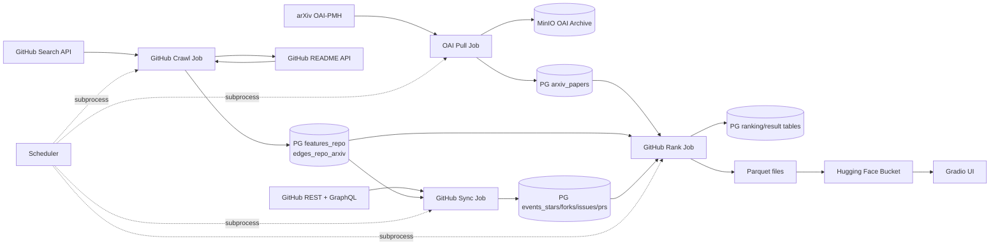

# arXiv Ranking
> Paper × Code × Citation Leaderboards

> 项目入口文档：本 README 说明 `arxiv-prod-lab-pipeline` 的职责、数据链路、运行方式、配置来源与测试入口，供开发和运维人员快速接手仓库。代码构建约束见 [`AGENTS.md`](./AGENTS.md)。

这个项目持续发现 README 中引用 arXiv 论文的 GitHub 仓库，同步仓库的 Star、Fork、Issue、PR 活跃度，并生成可按时间窗口查询的论文热度榜单。数据主链路以 PostgreSQL 为业务事实源，MinIO 保存按年月分区的 arXiv JSONL 归档，排名结果导出为 Parquet 后供 Gradio 前端读取。

## 核心能力

- **arXiv 增量采集**：通过 OAI-PMH `arXivRaw` 接口按天拉取论文元数据，按首版发布日期归档。
- **GitHub 关联发现**：按创建时间逐小时搜索 README 含 `arxiv` 的仓库，提取 arXiv ID 并建立论文与仓库关系。
- **仓库活跃度同步**：从 GitHub REST/GraphQL API 采集 Star、Fork、Issue、PR 事件，区分近 14 天增量窗口与全量轮巡。
- **多维热度排名**：生成 `d14`、滚动 7/30 天与 3/6 个月、YTD、年度、总榜等窗口的 Top 500。
- **断点续传**：每个 Job 使用 PostgreSQL 账本表记录水位、子任务进度和失败状态，支持超时、限流或进程退出后继续执行。
- **隔离调度**：常驻调度器通过独立子进程运行各个 Job，单个 Job 崩溃或超时不会直接拖垮其他 Job。
- **结果发布**：四张排名相关表导出为 Parquet，并可同步到 Hugging Face Bucket；`hf_gradio_ui/` 提供榜单浏览应用。

## 系统架构



主路径分为四段：

1. **论文入库**：OAI Pull 将 arXiv 元数据双写至 MinIO 与 PostgreSQL。
2. **关系发现**：Crawl Job 发现仓库、读取 README，并写入仓库特征与论文关联边。
3. **活跃度采集**：Sync Job 按仓库计算四类事件，写入按天聚合的 `events_*` 表。
4. **排名发布**：Rank Job 聚合事件与论文/仓库关系，覆盖生成排名表并导出 Parquet。

调度器只负责触发和监督，不直接导入业务模块。各 Job 的恢复语义由自己的状态表控制，因此重跑时从数据库水位继续，而不是依赖调度器内存。

## Job 一览

| Job | 调度方式 | 核心职责 | 主要输出 |
| --- | --- | --- | --- |
| `jobs.job_daily_arxiv_oai_pull` | 启动后执行，每小时检查 | 按 UTC 日期推进 OAI-PMH 拉取，默认从 `2026-08-30` 的历史起点开始 | `arxiv_oai_pull_log`、`arxiv_papers`、MinIO JSONL |
| `jobs.job_hourly_github_crawl` | 启动后执行，每小时检查 | 搜索新仓库、读取 README、提取 arXiv ID，按小时断点续传 | `features_repo`、`edges_repo_arxiv`、crawl 账本 |
| `jobs.job_hourly_github_sync` | 启动后执行，每小时检查 | 先追 P0 近 14 天窗口，再执行 P2 全量轮巡 | `events_stars`、`events_forks`、`events_issues`、`events_prs` |
| `jobs.job_daily_github_rank` | 启动后执行，每小时检查 | 每个数据库日期最多成功生成一次排名快照 | `ranking_top500`、`top500_arxiv_repo`、`paper_details`、`repo_details` 及 Parquet |

调度细节：

- 时区为 `Asia/Shanghai`，整点触发并加入 0–120 秒抖动。
- 调度器启动时按 30 秒间隔依次执行一轮 Job；这会立即访问真实外部依赖。
- 同一 Job 使用进程内锁和 `max_instances=1` 防止并发执行。
- 单次子进程默认超时 3300 秒；超时后由 Job 状态表支持下一轮续跑。
- GitHub 限流会保持当前任务为可恢复状态，不计作普通业务失败。

## 数据与排名语义

### 业务事实表

| 表 | 作用 |
| --- | --- |
| `arxiv_papers` | 以 `arxiv_id` 为主键的论文元数据 |
| `features_repo` | GitHub 仓库规范特征，以 `repo_id` 标识 |
| `edges_repo_arxiv` | 仓库与 arXiv 论文的关联边 |
| `events_stars` / `events_forks` / `events_issues` / `events_prs` | 四类按仓库、按天的活跃度事件 |

### 排名结果表

| 表 | 作用 |
| --- | --- |
| `ranking_top500` | 按快照日期、窗口、指标、名次组织的 Top 500 |
| `top500_arxiv_repo` | Top 500 论文与仓库的桥接关系 |
| `paper_details` | 论文详情、关联仓库和聚合指标 |
| `repo_details` | 仓库详情、关联论文和聚合指标 |

排名 Job 的 SQL 使用当前 PostgreSQL 日期作为快照日期，并通过事务内 advisory lock 防止并发执行。持久排名表采用覆盖写语义，历史执行结果由 `github_rank_run_log` 记录。

默认 Parquet 输出目录为 `/tmp/ranking`，可通过 `RANK_OUTPUT_DIR` 覆盖。文件名包括：

- `ranking_top500.parquet`
- `top500_arxiv_repo.parquet`
- `paper_details_github.parquet`
- `repo_details.parquet`

若配置了 `HF_BUCKET_PATH`，Rank Job 会调用 `hf sync` 上传这些文件；未配置时仅生成本地文件并跳过上传。

## 技术栈

| 类别 | 技术 |
| --- | --- |
| 语言与包管理 | Python `>= 3.14`、`uv`、`pyproject.toml` / `uv.lock` |
| 调度 | APScheduler 3 |
| 数据处理 | pandas、PyArrow、Parquet |
| 业务数据库 | PostgreSQL、`psycopg2` |
| 对象存储 | MinIO；Hugging Face Bucket 用于发布排名文件 |
| 外部数据源 | arXiv OAI-PMH、GitHub REST API、GitHub GraphQL API |
| 配置与密钥 | Infisical、`python-dotenv` |
| 前端 | Gradio（`hf_gradio_ui/`，独立依赖） |
| 部署 | Docker、Kubernetes / Kustomize |

Kafka Python 客户端与 `kafka-python` 依赖已移除；仓库仅保留独立的 KafkaTopic 部署清单。当前活跃数据流以 PostgreSQL、MinIO 和 Hugging Face Bucket 为准。

## 快速开始

### 前置条件

- Python 3.14 和 `uv`
- 可访问的 PostgreSQL 与 MinIO
- 有效的 GitHub Token
- Infisical 项目及其 `test` / `prod` 环境变量
- 可选的 Hugging Face Bucket 与 Token，用于发布 Parquet

项目当前没有提交 `.env.example`。本地 `.env` 已被 `.gitignore` 排除，只应保存启动配置加载所需的 Infisical 客户端信息，不应提交任何真实密钥。

### 1. 安装依赖

```bash
uv sync --frozen
```

### 2. 配置环境

`.env` 最小启动字段：

```dotenv
ENV=test
INFISICAL_CLIENT_ID=...
INFISICAL_CLIENT_SECRET=...
INFISICAL_PROJECT_ID=...
```

可选字段：

```dotenv
INFISICAL_HOST=https://app.infisical.com
INFISICAL_SECRET_PATH=/
```

`common.config` 在首次访问配置字段时才连接 Infisical，并从对应的 `test` 或 `prod` 环境读取业务配置。因此 `ENV` 必须在任何配置访问前设置。

### 3. 验证配置

只打印字段名，不输出真实值：

```bash
ENV=test uv run python tests/smoke_test/smoke_config.py --keys-only
```

该命令会检查字段是否全部注入以及类型是否正确。默认模式也会对值脱敏；`--verbose` 仅应在可信的交互式终端中使用。

### 4. 初始化 GitHub 发现水位

Crawl 和 Sync 的历史基线是 `2026-06-16`。首次联调时先初始化 Crawl 账本：

```bash
ENV=test uv run python -m jobs.job_hourly_github_crawl init
```

该命令会连接真实测试环境 PostgreSQL，并按需创建状态表和基线记录。

### 5. 启动调度器

```bash
ENV=test uv run python -m jobs.scheduler
```

调度器启动后就会依次触发四个 Job，而不是只监听下一次整点。按 `Ctrl+C` 或发送 `SIGTERM` 可进入优雅退出流程。

## 单独运行 Job

适合局部联调、排障和状态检查：

```bash
ENV=test uv run python -m jobs.job_daily_arxiv_oai_pull
ENV=test uv run python -m jobs.job_hourly_github_crawl run
ENV=test uv run python -m jobs.job_hourly_github_crawl verify
ENV=test uv run python -m jobs.job_hourly_github_sync run
ENV=test uv run python -m jobs.job_hourly_github_sync verify
ENV=test uv run python -m jobs.job_daily_github_rank run
ENV=test uv run python -m jobs.job_daily_github_rank verify
```

OAI Pull 默认只有无参数入口。Crawl 支持 `init`、`run`、`verify`；Sync 和 Rank 支持 `run`、`verify`。

## 测试

先运行不依赖真实外部服务的单元测试：

```bash
uv run pytest tests/jobs/unit -q
```

集成测试主要面向已配置的镜像 PostgreSQL，并可能调用真实 GitHub / arXiv API：

```bash
uv run pytest tests/jobs/integration -q
```

可控开关：

| 环境变量 | 默认行为 | 作用 |
| --- | --- | --- |
| `GITHUB_TEST_REAL_API=0` | 默认为 `1` | 关闭真实 GitHub API 调用 |
| `OAI_TEST_REAL_API=1` | 默认为 `0` | 开启真实 arXiv OAI 调用 |
| `RANK_TEST_FULL_SQL=1` | 默认为 `0` | 执行完整排名 SQL 与 Parquet 导出测试 |

`pytest.ini` 已声明 `integration`、`e2e`、`coordination` 标记，但当前测试目录仍有依赖真实基础设施的用例。运行测试前应确认 `ENV` 指向允许清理隔离测试数据的数据库，避免将测试任务写进生产环境。

## 配置说明

### 启动与密钥加载

| 配置 | 来源 | 说明 |
| --- | --- | --- |
| `ENV` | 进程环境 / `.env` | 仅接受 `test` 或 `prod` |
| `INFISICAL_CLIENT_ID` | 进程环境 / `.env` / K8s Secret | Infisical 客户端身份 |
| `INFISICAL_CLIENT_SECRET` | 进程环境 / `.env` / K8s Secret | Infisical 客户端密钥 |
| `INFISICAL_PROJECT_ID` | 进程环境 / `.env` / K8s Secret | 密钥项目 ID |
| `INFISICAL_HOST` | 可选，默认官方地址 | Infisical 服务地址 |
| `INFISICAL_SECRET_PATH` | 可选，默认 `/` | 密钥路径 |

### Infisical 中需要的业务字段

| 分类 | 字段 |
| --- | --- |
| PostgreSQL | `PG_HOST`、`PG_PORT`、`PG_DB`、`PG_USER`、`PG_PASSWORD` |
| MinIO | `MINIO_BUCKET`、`MINIO_ENDPOINT`、`MINIO_ACCESS_KEY`、`MINIO_SECRET_KEY` |
| GitHub | `GITHUB_TOKEN` |
| Hugging Face | `HF_BUCKET_PATH`、`HF_TOKEN`、`HF_ENDPOINT` |

`HF_BUCKET_PATH` 和 `HF_TOKEN` 缺失时视为空值，`HF_ENDPOINT` 默认 `https://hf-mirror.com`。同名的进程环境变量可覆盖 Infisical 中的 Hugging Face 配置，便于本地联调。

## 目录结构

```text
.
├── common/                    # 配置、日志、PG、MinIO 等共享基础设施
├── jobs/
│   ├── scheduler.py           # 常驻调度器与子进程执行框架
│   ├── job_*.py               # 四条业务 Job
│   ├── rank_sql/              # GitHub × arXiv 排名 SQL
│   └── upload_hf.sh           # Hugging Face Bucket 上传包装
├── hf_gradio_ui/              # 读取 Parquet 的 Gradio 榜单应用
├── k8s/                       # 调度器 Deployment、Kustomize 与独立 KafkaTopic 清单
├── docker/Dockerfile          # 两阶段构建的调度器运行镜像
├── src/arxiv_prod_lab_pipeline/
│   └── __init__.py            # 预留 Python 包命名空间
├── tests/
│   ├── jobs/unit/             # 单元测试
│   ├── jobs/integration/      # 真实 PG / API 集成测试
│   ├── smoke_test/            # 配置冒烟检查
│   └── feasibility_test/      # 数据源与容量可行性实验
├── pyproject.toml             # 主项目依赖
├── uv.lock                    # 锁定的依赖版本
└── pytest.ini                 # 测试路径、标记和日志配置
```

## Docker 与 Kubernetes

构建调度器镜像：

```bash
docker build -f docker/Dockerfile -t arxiv-prod-lab-pipeline:local .
```

镜像只复制 `common/` 和 `jobs/`，入口为 `python -m jobs.scheduler`。运行容器时仍需提供 `ENV` 与三项 Infisical 启动凭据。

`k8s/deployment.yaml` 当前按单副本运行，并把 Infisical 客户端信息从名为 `infisical` 的 Secret 注入。应用前需确保：

- `arxiv` Namespace 已存在。
- `infisical` Secret 已包含 `client_id`、`client_secret`、`project_id`。
- 镜像名和标签已替换为目标环境构建产物。

```bash
kubectl apply -k k8s
```

`k8s/test/kafka-topic.yaml` 与 `k8s/prod/kafka-topic.yaml` 是独立 KafkaTopic 清单，没有被 `k8s/kustomization.yaml` 自动包含。

## 运行约束

- **仅支持单副本调度**：当前防并发依赖进程内 `threading.Lock`；扩展到多个调度副本前，需要改为 PostgreSQL advisory lock 或等价分布式锁。
- **调度时区与业务日期不同**：调度触发使用上海时区，OAI/Crawl/Sync 的追赶目标使用 UTC 昨天。
- **启动即访问外部系统**：调度器启动后会立即执行所有 Job，本地调试时应先确认 `ENV` 和数据库目标。
- **排名表是快照覆盖写**：PostgreSQL 排名结果不保留多日历史，Parquet 也只镜像当前排名表。
- **Kafka Python 支持已移除**：当前无 `kafka-python` 依赖或客户端模块；仅保留独立 Topic 清单供未来部署使用。
- **前端是独立子项目**：Gradio 依赖不在根 `pyproject.toml` 中，需在 `hf_gradio_ui/` 按其 `requirements.txt` 单独安装。
